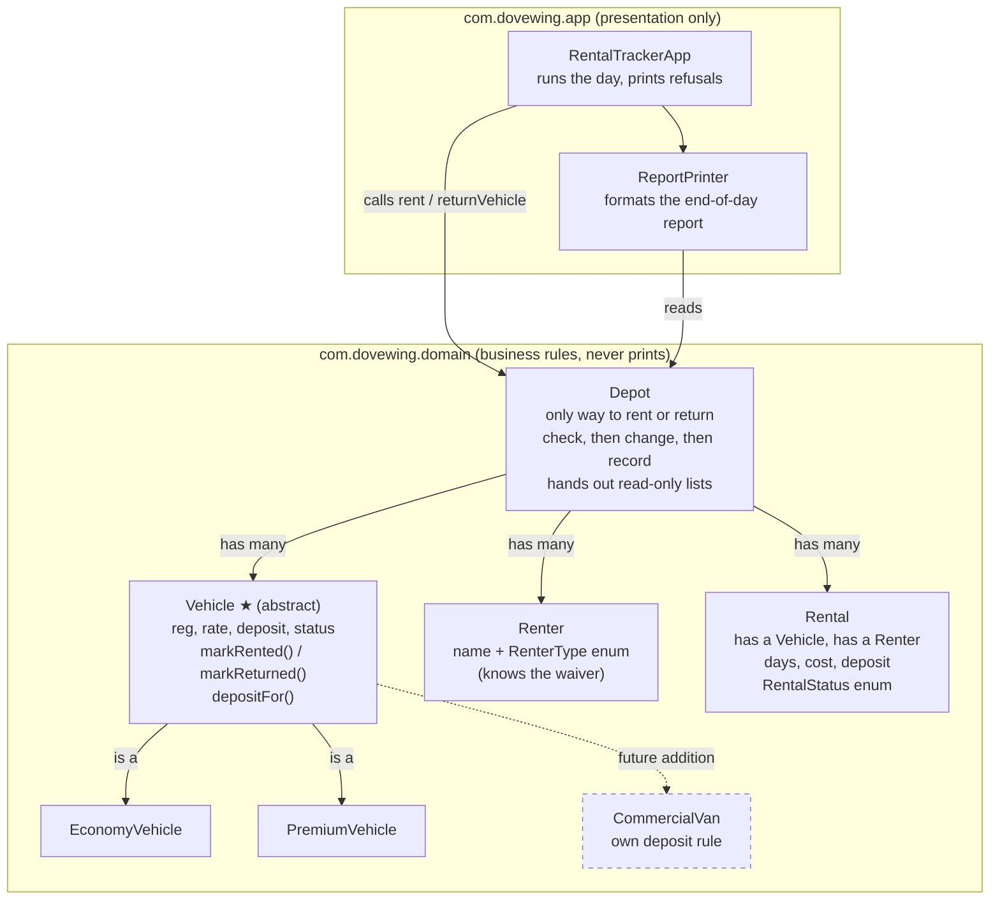

# Dovewing Car Rentals => Code Diagnosis

## 1. Overview

The Dovewing Car Rentals tracker lets the front desk register vehicles and
renters, rent and return vehicles, and print an end-of-day report. It compiles
and runs, but the staff keep a paper backup because they do not trust it.

This diagnosis identifies the defects behind that distrust, explains the root
cause of each one and the risk it creates for Dovewing, and ranks them by how
much they matter to this business.

## 2. How I ran it

I ran the starter exactly as delivered, before changing any code:

```bash
javac -d target/classes src/main/java/RentalTracker.java
java -cp target/classes RentalTracker > docs/original-output.txt
```

The full output is in [docs/original-output.txt](docs/original-output.txt).


## 3. The impossible line

```text
Fleet status:
  Toyota Vitz (GT-1234-20, ECONOMY): RENTED
Active rentals:
  Rental #1: GT-1234-20 -> Kofi Mensah (3 days)
  Rental #3: GT-1234-20 -> Ama Owusu (2 days)
```

One car has two active rentals. The Vitz was rented to Ama while Kofi still had
it, and the program accepted it without any warning.

## 4. Defects, ranked by risk to Dovewing

### 4.1 A rented vehicle can be rented again, and a return closes every rental on it => Critical

**Problem:** `rent()` accepts a vehicle that is already out. `returnVehicle()`
then marks every active rental with that registration as `RETURNED`.

**Root cause:** The rule "one car, one renter at a time" has no owner. `Vehicle`
holds the status but cannot defend it, `rent()` changes it without checking it,
and `returnVehicle()` finds rentals by registration text alone, so it closes
every active rental for that car instead of the one being returned.

**Business impact:** The same car is promised to two customers. When Kofi brings
the Vitz back, Ama's rental is closed as well, even though she was given the
car. The depot loses the record of who has the car and which deposit is still
owed.

**Proposed direction:** A vehicle will refuse to be rented while it is out, and a
return will close exactly one rental: the active rental for that vehicle.

### 4.2 Every field is public => Critical

**Problem:** All fields on `Vehicle`, `Renter` and `Rental` are public, and so are
the depot's `vehicles` and `renters` lists.

**Root cause:** No encapsulation. No object can protect its own data or enforce
its own rules.

**Business impact:** Any line of code can set a rented car back to `AVAILABLE`,
change a daily rate or deposit after a booking, or remove a car from the fleet,
with nothing to stop it or record it. Even a correct `rent()` method could be
undone from outside.

**Proposed direction:** All fields will be private. State will change only through
methods that describe a business action (rent, return) and check their rules,
with no public setters.

### 4.3 The rental records are handed out => Critical

**Problem:** `rentals` is the only private field in `Depot`, but `getRentals()`
returns the live list itself.

**Root cause:** A leaked mutable reference.

**Business impact:** Any caller can edit or delete rental records. A single call to
`getRentals().clear()` wipes the day's rentals, which are the depot's only record
of money and deposits owed.

**Proposed direction:** The depot will only hand out read-only copies of its lists.

### 4.4 The same fact is stored in several places => High

**Problem:** Whether a car is out is recorded in `Vehicle.status` and in each
`Rental.status`, and a third free-text copy is kept in `Renter.history`.

**Root cause:** No single source of truth. Each copy is updated separately, and
nothing keeps them in step.

**Business impact:** This is the exact symptom the owner reports: "sometimes a car
shows as available and rented at the same time." After the double rental, the
original output shows one car with two active rentals, and a mistyped category
(see 4.5) leaves a car `AVAILABLE` while an active rental exists for it. Staff
cannot trust either record, so they keep a paper one.

**Proposed direction:** One class will own a car's status, and it will only change
together with the rental record, inside a single depot operation, so the two can
never disagree. A renter's history will be read from the real rental records
instead of being kept as separate text.

### 4.5 Fixed categories and statuses are typed as free text => High

**Problem:** Vehicle category, renter type and statuses are plain strings.

**Root cause:** A closed set of values is modelled as open text, so the compiler
cannot catch a mistake and the code fails silently.

**Business impact:** A car entered with category `"Economy"` instead of
`"ECONOMY"` matches neither pricing branch in `rent()`, but the last two lines of
the method run anyway, so an active rental is still recorded at GHS 0.0 cost and
GHS 0.0 deposit while the car stays `AVAILABLE`: a free rental, recorded as real,
for a car the fleet shows as free. A renter entered as `"Member"` fails the
waiver check and is charged the full deposit, which leads to disputes at the
counter.


**Proposed direction:** These strings will be replaced with enums (`RenterType`,
`VehicleStatus`, `RentalStatus`) and the category string with vehicle types, so a
typo becomes a compile error.

### 4.6 Pricing and deposit rules are copy-pasted inside one method => High

**Problem:** The economy and premium branches of `rent()` are identical: the same
cost calculation, the same member waiver, the same status change and message.

**Root cause:** Behaviour that belongs to each vehicle class sits in one central
method, and a shared rule has no single home.

**Business impact:** Every change means editing the same method, and a change to
one branch can silently miss the other. The brief records that this has already
happened: a tweak to premium pricing once broke how economy returns were
handled. Adding the commercial van to this design would mean a third branch and
a third copy of the member waiver in the same method, putting economy and
premium at risk again.

**Proposed direction:** Each vehicle class will supply its own deposit rule, the
member waiver will live in one place, and `rent()` will contain no branching on
vehicle category.

### 4.7 Inputs and business rules are not validated — High

**Problem:** Nothing checks rental days, rates, deposits, names, or whether a
vehicle or renter belongs to the depot.

**Root cause:** Constructors and business methods accept any value without
checking it against the business rules.

**Business impact:** Nothing stops a rental of -2 days: on the Vitz it would be
recorded with a cost of GHS -300.0, meaning the depot would owe the customer. Blank names,
negative rates or deposits, and vehicles never added to the depot are all
accepted, so the records can be wrong from the moment they are created.

**Proposed direction:** Constructors and depot operations will check their inputs
and refuse invalid requests with an exception before any state changes.

### 4.8 A vehicle can be "returned" when it was never out — Medium

**Problem:** `returnVehicle()` sets the car to `AVAILABLE` and prints "Returned"
without checking that the car had an active rental.

**Root cause:** The state is changed before the request is checked.

**Business impact:** A car that was never rented, or never even added to the
depot, still prints "Returned". Staff are told a return happened when nothing
was out.

**Proposed direction:** A return will be refused unless the vehicle has an active
rental.

### 4.9 Rentals refer to renters and vehicles by text => Medium

**Problem:** `Rental` stores the renter's name and the vehicle's registration as
strings, not the actual `Renter` and `Vehicle` objects.

**Root cause:** Relationships are modelled as copied text instead of object
references.

**Business impact:** Two renters with the same name cannot be told apart, so a
rental can be credited to the wrong customer, and every lookup depends on exact
text matching.

**Proposed direction:** Each `Rental` will hold references to its actual `Vehicle`
and `Renter`.

### 4.10 Business logic prints its own output => Medium

**Problem:** `rent()`, `returnVehicle()` and `printReport()` print to the console
while also applying business rules.

**Root cause:** Business logic and presentation are mixed in the same methods.

**Business impact:** The rules cannot be reused for a receipt, a screen or an SMS,
or checked automatically, without copying them.

**Proposed direction:** Business classes will return results. A separate class in
the application layer will format and print them, which is also how the output
will stay identical to the original.

### 4.11 Structure, naming and lower-risk implementation choices => Low

**Problem:** All five classes are in one file with no packages. The code uses
`import java.util.*`, single-letter names (`d`, `r`, `v`, `rt`), IDs from shared
static counters, and `double` for money.

**Root cause:** Poor structure and naming, global mutable state, and an imprecise
type for money.

**Business impact:** The code is harder to read, change and hand over. IDs are
shared across every depot in the program, and `double` can produce rounding
errors in money totals.

**Proposed direction:** One class per file in clear packages, descriptive names,
explicit imports, and IDs generated per depot. `double` will be kept so the
printed amounts stay identical to the original (for example `GHS 450.0`); the
rounding risk is noted for a future change.

## 5. The most dangerous problem

The most dangerous defect is 4.1: a vehicle can be rented while it is already
out, and returning it closes every rental on it.

The whole purpose of the tool is to answer one question at the desk: who has
this car right now? Today the program can give the same car to two people and
keep two active rentals for it, as the original end-of-day report shows. When
the car comes back, it closes both rentals, even though only one car was
returned. From then on, the depot cannot say who has the car, which renter
still owes a deposit, or whether a car shown as free is really in the yard.

This is why the staff no longer trust the tool and keep a paper backup.
Defects 4.2 to 4.5 make it worse: because every field is public, the records
are handed out and the same facts are stored twice, so even a correct `rent()`
method could be undone from somewhere else. Enforcing "a vehicle has at most
one active rental" is therefore the central priority of the rebuild.

## 6. Planned structure

- **Packages:** `com.dovewing.domain` holds the business rules and never prints;
  `com.dovewing.app` holds `main` and the report printer.
- **Vehicle** (abstract) holds what every vehicle shares: model, registration,
  daily rate, deposit and status, all private. It **owns the status rule**: its
  package-private `markRented()` and `markReturned()` refuse an invalid change by
  throwing an unchecked exception. **EconomyVehicle** and **PremiumVehicle**
  extend it, and each decides its own deposit rule.
- **Renter** holds a name and a `RenterType` enum (`CASUAL`, `MEMBER`); the enum
  knows whether the deposit is waived.
- **Rental** holds its `Vehicle` and `Renter` objects and a `RentalStatus` enum.
  It is a class, not a record, because its status changes when the car returns.
- **Depot** is the only way to rent or return a car. It checks the request first,
  then changes state, then records the rental, so a refused request changes
  nothing. It only hands out read-only lists.
- **The rule this enforces:** a vehicle is `RENTED` exactly when one active rental
  refers to it, and only `Depot` can change either side.

## 7. Design sketch



★ Vehicle is responsible for protecting its own status rule.

## 8. How the commercial van fits

To add the commercial van, I will add one class, `CommercialVan extends
Vehicle`, with its own deposit rule. I will not touch `Depot`, `Rental`,
`Renter`, `EconomyVehicle`, `PremiumVehicle` or the report printer. In the
original program, the same change means a third branch in `rent()`, a third
copy of the member waiver, and another string that only works if typed exactly
right.

## 9. Expected outcome

The rebuild will keep every original feature, rental calculation, deposit rule
and report line, while enforcing the rule that a vehicle cannot have more than
one active rental. It will be encapsulated, organised by responsibility, and
able to take on the commercial van without a rewrite.

The only intended difference in output: the second rental of the Vitz is now
refused, so the end-of-day report shows one active rental (#1) instead of two.
